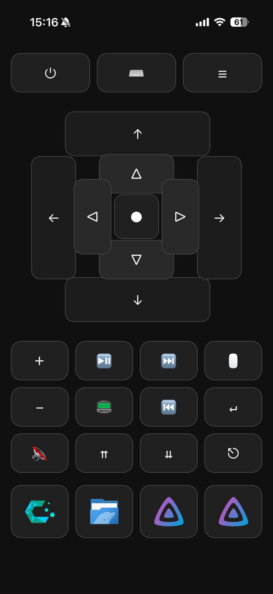
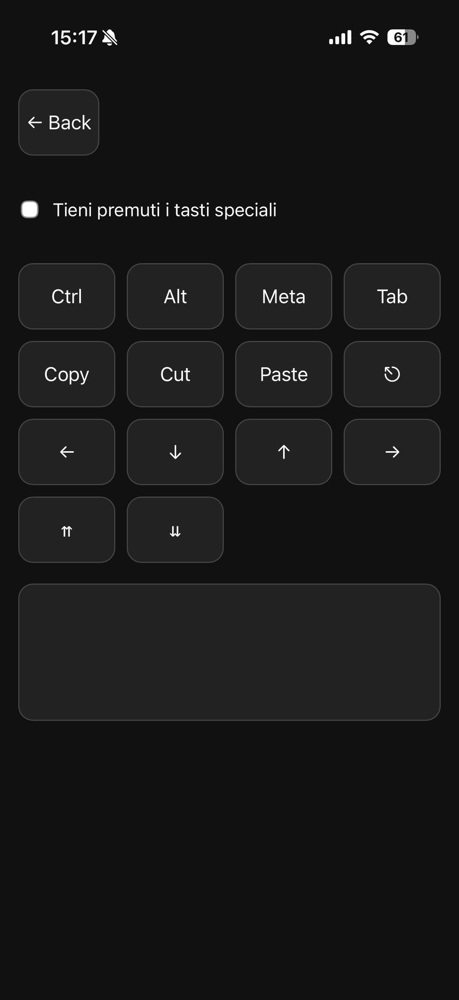
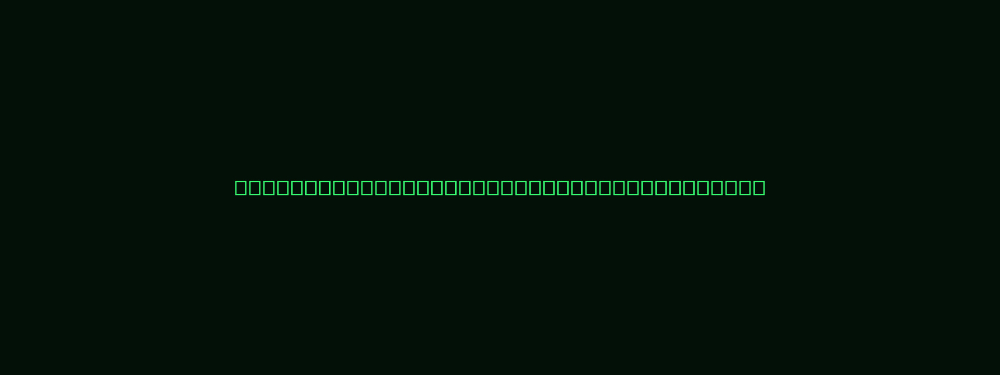

# KDE Media Remote — V2.1

Prima stesura focalizzata su CachyOS + KDE Plasma + Wayland.

<p align="center">
  
  
  <br />
  
</p>

## Architettura

Telefono/tablet -> WebSocket -> FastAPI -> ydotool -> uinput -> KDE/Wayland

La UI è servita dallo stesso processo FastAPI.

## 1. Dipendenze di sistema

Su CachyOS/Arch:

```bash
sudo pacman -S ydotool python python-pip
```

Il pacchetto Arch contiene `ydotool`, `ydotoold`, una unità systemd utente e una regola udev per uinput.

Avvia il daemon:

```bash
systemctl --user enable --now ydotool.service
```

Verifica:

```bash
systemctl --user status ydotool.service
ydotool mousemove -x 20 -y 0
```

Se il daemon non riesce ad accedere a `/dev/uinput`, controllare la regola udev e i permessi sul sistema prima di cambiare il codice.

## 2. Ambiente Python

```bash
cd kde-media-remote-v0
python -m venv .venv
source .venv/bin/activate
pip install -r requirements.txt
```

## 3. Primo avvio: crea un account

Prima di avviare il server serve almeno un account. Il telecomando con
accesso libero può iniettare tasti e lanciare comandi: non è una pagina
da lasciare aperta.

```bash
python tools/accounts.py add pietro
```

Il PIN viene chiesto due volte con input nascosto, quindi non finisce
nella cronologia della shell. Poi avvia il server:

```bash
python run.py
```

Porta e indirizzi arrivano da `config/config.toml`:

```toml
[server]
port = 8765
bind = ["loopback", "tailscale"]
```

`bind` è una lista, non un host: ogni voce apre un socket sulla stessa
porta. `"loopback"` dà `127.0.0.1` e `::1` (questo portatile),
`"tailscale"` dà l'indirizzo di `tailscale0` (il telefono). Override
d'ambiente con una lista separata da virgole o spazi:

```bash
KMR_BIND="loopback,tailscale" KMR_PORT=8765 python run.py
```

Al primo accesso il browser chiede il PIN.

## 4. Accesso: Tailscale e reverse proxy HTTPS

Con la configurazione sopra il server è in chiaro su due indirizzi:
loopback per il portatile, `tailscale0` per il telefono. Il fallback
diretto, sempre disponibile, è:

```
http://<indirizzo-o-nome-magicdns>:8765
```

Quel traffico resta in HTTP ma non esce in chiaro dalla tailnet: la
cifratura la fa il tunnel WireGuard di Tailscale.

Per installare la PWA su Android serve però un secure context (HTTPS).
Il telefono non parla direttamente con questo PC: passa da Nginx Proxy
Manager (NPM) su `atlante`, che termina TLS e inoltra in HTTP sulla
tailnet.

```
telefono --HTTPS--> NPM (atlante) --HTTP/tailnet--> questo PC:8765
```

### Nginx Proxy Manager

1. DNS: un record A (e AAAA se usi IPv6) per esempio
   `remote.example.com` punta all'IP pubblico di casa. Le porte 80 e
   443 del router vanno inoltrate all'IP LAN di `atlante`.
2. In NPM (`http://<IP-TAILSCALE-NPM>:81`) crea un Proxy Host:
   - Domain: `remote.example.com`
   - Scheme: `http`
   - Forward Hostname/IP: `<IP-TAILSCALE-PC>` (l'IP Tailscale di questo PC;
     così NPM non ha bisogno della MagicDNS)
   - Forward Port: `8765`
   - Websockets Support: ON
   - Block Common Exploits: ON
3. Nella scheda SSL richiedi un certificato nuovo, attiva Force SSL e
   HTTP/2. Se metti Cloudflare davanti, imposta SSL/TLS su
   `Full (strict)`.
4. Apri `https://remote.example.com/`, fai login e controlla che il
   badge dica "Connesso".

Il service worker `/sw.js` è servito dalla radice e viene registrato
solo in HTTPS (o su `localhost`). Restano da fare nella fase PWA le
icone, i colori del manifest e il pulsante "Installa app".

### Proxy fidato

NPM va elencato in `config/auth.local.toml` (file locale, **non versionato**):

```toml
[auth]
trusted_proxy_ips = [
    "<IP-TAILSCALE-NPM>",
    "<IPv6-TAILSCALE-NPM>",
]
```

`config/auth.toml` contiene solo la lista vuota e i valori predefiniti;
il file `.local` sovrascrive le chiavi che imposti. Solo da questi peer
il server legge `X-Real-IP` / `X-Forwarded-For`.
Se NPM esce con un altro indirizzo (per esempio un bridge Docker non
NATtato), `/auth/revoke` resterebbe remoto e il rate limit userebbe
l'IP del proxy: aggiungi l'indirizzo che vedi in `journalctl` e riavvia
il servizio.

Al boot `tailscale0` non ha ancora un indirizzo: `tailscaled` lo prende
qualche secondo dopo il login. Per questo `run.py`, se gli chiedi
`"tailscale"`, aspetta fino a 30 secondi che l'indirizzo compaia prima di
aprire la porta, invece di partire sul solo loopback e lasciare il
telefono fuori. Se Tailscale non è collegato del tutto parte lo stesso,
con un avviso a console: il portatile resta comunque raggiungibile.

Il servizio systemd copre il caso normale:

```bash
systemctl --user restart kde-media-remote
```

Se dopo un riavvio il telefono non si collega, guarda i socket aperti:

```bash
ss -tln | grep 8765
```

Devono comparire quattro righe: due per il loopback (`127.0.0.1` e
`::1`) e due per `tailscale0`. Se mancano quelle di Tailscale,
`tailscaled` non era pronto e il bind è andato solo sul loopback.

Sulla LAN **non c'è nessun socket del telecomando**: il Wi-Fi di casa
non ha nulla su cui collegarsi. L'unica porta pubblica è quella di NPM
(80/443) su `atlante`; l'app resta dietro login e sessione, ma non è
più raggiungibile solo dalla tailnet. `tailscale serve` e
`tailscale funnel` continuano a non servire e non vanno usati.

Se un giorno vuoi cambiare gli indirizzi, basta la lista in
`config/config.toml`. I valori possibili sono `loopback`, `tailscale`,
`0.0.0.0` (tutta la LAN, sconsigliato: il launcher lo segnala a
console) e un IP esplicito.

## Mouse "telecomando TV"


Parametri in `config/config.toml`:

```toml
mouse_step = 22
mouse_repeat_ms = 70
mouse_accel_after_ms = 500
mouse_accel_multiplier = 2.2
```

Quando tocchi una direzione interna:

1. parte subito il movimento;
2. finché tieni premuto, il server invia uno step ogni `mouse_repeat_ms`;
3. dopo `mouse_accel_after_ms` ogni step viene moltiplicato per `mouse_accel_multiplier`;
4. al `pointerup` il movimento viene cancellato immediatamente.

Questo evita di aspettare 500 ms prima di capire se volevi un tap: il tap è reattivo subito, mentre la pressione lunga diventa progressivamente più veloce.

## Config

- `config/config.toml`: porta, indirizzi di ascolto (`bind`), velocità mouse, opzioni.
- `config/commands.toml`: comandi programmabili.
- `config/bindings.toml`: quattro app/command binding.
- `config/auth.toml`: scadenze e limiti dell'autenticazione.
- `data/auth.db`: hash dei PIN e sessioni. **Non va nel versionamento.**

## Stato V0

Implementato:
- D-pad esterno -> frecce tastiera
- D-pad interno -> movimento mouse continuo
- accelerazione dopo pressione lunga
- click sinistro/destro
- media keys
- pagina keyboard
- Ctrl/Alt/Meta con modalità hold
- input tastiera telefono
- commands da TOML
- aggiunta commands dalla web UI
- 4 binding
- lettura base dei `.desktop`
- autenticazione a PIN, max 7 account
- sessione ricordata 4 mesi con timer di inattività a 20 giorni
- un solo device connesso per account
- pagina di revoca device, solo da macchina locale
- ascolto su loopback e tailscale0; accesso esterno via Tailscale o NPM

Da fare:
- icone reali dei `.desktop`
- editor completo bindings
- settings web
- service systemd del remote
- gestione migliore Unicode/clipboard
- PWA: icone, colori manifest, pulsante "Installa app" (service worker
  già pronto)
- allow-list di file in /static


## V0.1 UI / KDE launcher

### App Binding icons

For `type = "app"`, the server reads `Icon=` from the matching `.desktop` file and resolves the icon from common KDE/Linux icon theme directories.

Frontend behavior:
- icon found -> show the real application icon
- icon not found -> show `name` over the configured `color`

For `type = "command"`, there is no `.desktop` icon by definition, so the normal fallback is `name + color`.

### KDE launcher

After the virtual environment has been installed:

```bash
./install-desktop.sh
```

Then search for **KDE Media Remote** in Plasma's application menu and pin it to the taskbar.

The launcher runs:

```text
PROJECT/.venv/bin/python PROJECT/run.py
```

so it does not depend on Fish, Bash, or activating the venv.


## V0.2 - Phone keyboard fix

The phone keyboard now keeps a real textarea state instead of clearing the
field after each character.

It uses `beforeinput` to distinguish:
- inserted text
- Backspace
- Enter
- some iOS replacement/composition events

This fixes the iOS behavior where every letter was treated as the start of a
new sentence and therefore auto-capitalized.


## V0.3 - Icon override per App Bindings

Ogni binding può opzionalmente avere:

```toml
icon = ""
```

Priorità icona:
1. `icon="..."` nel binding
2. campo `Icon=` del file `.desktop`
3. fallback frontend `name + color`

`icon` può essere:
- un percorso assoluto, ad esempio `/home/user/Pictures/zen.svg`
- un nome icona del tema, ad esempio `zen-browser`
- un nome file come `zen-browser.svg`

Esempio:

```toml
[[bindings]]
slot = 1
type = "app"
name = "Zen Browser"
desktop = "zen.desktop"
icon = "/home/user/Pictures/zen.svg"
color = "#6b5cff"
```

Se `icon=""`, il server usa automaticamente l'icona dichiarata nel `.desktop`.


## V0.4 - iPhone keyboard value-diff sync

The phone textarea is now synchronized by comparing the complete previous and
current textarea values after each input event, instead of relying on iOS
`beforeinput` key semantics.

This supports normal continuous typing, Backspace, replacement/paste and Enter
more reliably on mobile Safari.

iOS autocapitalization, autocorrect and spellcheck are disabled for the remote
input field so the browser does not silently rewrite the remote stream.


## V0.5 - Autenticazione a PIN

Ogni rotta (tranne il form di login e gli asset statici) richiede una
sessione valida. Il middleware riscontra la sessione a ogni richiesta, e
anche il WebSocket `/ws` la riverifica continuamente: una revoca vale per
la richiesta successiva, non per la successiva-orama.

### Modello

Massimo 7 account attivi, ciascuno con un PIN.

- **Un device per account.** Il login successivo revoca la sessione
  precedente e apre una nuova: se lo stesso account si ricollega da un
  altro telefono, il device vecchio cade da solo.
- **Scadenza assoluta 4 mesi** dalla creazione della sessione. Non si
  ricarica nemmeno con l'uso continuo.
- **Timer di inattività 20 giorni**, indipendente dal primo. Se l'account
  non viene usato per 20 giorni scade e va rifatto il login.
- **5 tentativi di login sbagliati** per IP: il sesto aspetta 5 minuti.
  La finestra di conteggio è di 60 secondi.
- **PIN mai in chiaro**: PBKDF2-HMAC-SHA256, 240000 iterazioni, salt
  casuale per account. Nel DB c'è solo l'hash.
- **Token di sessione mai in chiaro**: nel DB c'è solo lo SHA-256. Un
  dump di `data/auth.db` non permette di impersonare nessuno.
- Cookie `HttpOnly` + `SameSite=Lax`. Il flag `Secure` si mette da solo
  solo se la richiesta arriva davvero su HTTPS: in HTTP il browser
  accetterebbe il cookie su una connessione in chiaro e si romperebbe il
  login. Sopra HTTPS non c'è, ma la sessione resta dentro il tunnel
  Tailscale, che è già cifrato.

Le scadenze si cambiano in `config/auth.toml`, non serve toccare il codice.

### Gestire gli account

```bash
python tools/accounts.py list                  # account, ruolo, sessioni
python tools/accounts.py add <nome> [--admin]  # crea (max 7)
python tools/accounts.py admin <id> [--revoke] # ruolo admin
python tools/accounts.py remove <id> [-y]      # elimina
python tools/accounts.py rename <id> <nome>
python tools/accounts.py pin <id>              # cambia PIN
python tools/accounts.py disable <id>          # disattiva, libera uno slot
python tools/accounts.py enable <id>
python tools/accounts.py sessions              # device collegati
python tools/accounts.py revoke-all            # scollega tutto
```

Usa sempre `.venv/bin/python`: il `python` di sistema non ha `tomlkit` e
fallisce con `ModuleNotFoundError`.

Note:

- `add`, `pin` e `rename` chiedono conferma. Il PIN viene letto con
  `getpass`, quindi non finisce nella cronologia della shell né nella
  lista dei processi. Da script: `--pin-on-stdin`.
- `disable` **non** cancella l'account: lo tiene disattivato e libera
  uno slot sui 5. Serve per sospendere qualcuno senza perdere la sua
  cronologia di sessioni.
- `remove` cancella l'account **e tutte le sue sessioni**: chiunque
  avesse quel PIN dovra' rifare il login.
- `pin` e `remove` disconnettono subito i device collegati a quell'account.
- I nomi sono unici: il login cerca per nome, quindi due account con lo
  stesso nome renderebbero il login ambiguo.

### Gestire gli account dal sito

C'è una pagina dedicata: **`/auth/accounts`**, raggiungibile anche dal
telefono. Da lì si vede la situazione e si agisce.

Con un **account admin** puoi fare tutto: creare un account, cambiargli
il PIN, disattivarlo, riattivarlo, promuoverlo a admin, cancellarlo.
Con un **account normale** puoi soltanto cambiare il tuo PIN: niente
tabella degli altri, niente creazione, niente cancellazione. Le azioni
che un utente normale potrebbe usare per prendere il controllo restano
all'admin.

Il primo account va creato dalla CLI, perché senza account non c'è
nemmeno chi possa fare il login per crearli:

```bash
.venv/bin/python tools/accounts.py add pietro --admin
```

Se un giorno ti dimentichi qual è l'admin, o resti fuori perché
l'ultimo admin è stato cancellato, la CLI è sempre la via d'uscita:

```bash
.venv/bin/python tools/accounts.py list          # ruolo di ciascuno
.venv/bin/python tools/accounts.py admin 2       # promuove il #2
.venv/bin/python tools/accounts.py admin 2 --revoke   # toglie il ruolo
```

**L'ultimo admin attivo non può essere né declassato, né disattivato,
né cancellato**, dalla pagina o dalla CLI. È la rete che impedisce di
chiudere la porta a sé stessi: senza nessun admin in circolo non
potresti più creare account, e l'unica via di recupero resterebbe la
CLI. Se serve un secondo admin, crealo prima di togliere il primo.

Ogni azione viene annotata sul log del server (`[auth] ...` in
`~/.local/state`/journal o nell'output di `run.py`): chi ha cancellato
cosa, e quando.

I form della pagina hanno un token anti-CSRF legato alla sessione: un
POST che arriva senza quel token viene respinto con 403 anche se
riusciresti a farlo arrivare da un'altra pagina.

### Revocare i device

Si apre solo dal portatile, in `http://127.0.0.1:8765/auth/revoke`.
Dal telefono risponde 403 anche con un PIN valido.

Il controllo guarda l'indirizzo reale del client: il peer TCP, oppure
l'IP dichiarato da NPM se il peer è un proxy fidato. Il telefono arriva
con un peer `100.x` di Tailscale (o passa da NPM) e quindi non passa.
Le intestazioni `X-Forwarded-For` vengono lette solo se il peer è un
proxy elencato in `config/auth.toml`; altrimenti sarebbero un buco,
perché un device remoto potrebbe mandare `X-Forwarded-For: 127.0.0.1`.
Vale la stessa regola per i PIN: un device che si spaccia per locale
non ottiene nulla che non abbia già.

Il reverse proxy attuale è NPM su `atlante`:

```toml
[auth]
trusted_proxy_ips = [
    "<IP-TAILSCALE-NPM>",
    "<IPv6-TAILSCALE-NPM>",
]
```

Questo blocco va nel file locale `config/auth.local.toml`, non in
quello versionato. Se cambi proxy o NPM esce con un altro IP, aggiorna
quella lista e riavvia il servizio. Con NPM fidato, `/auth/revoke` continua a
rispondere 403 al telefono: l'IP reale è quello del telefono, non
`127.0.0.1`.

Da lì si vede la lista dei device collegati (account, da dove, IP, ultimo
uso) e si può disconnettere:

- un device singolo
- tutti i device

`POST /auth/revoke` con `action=revoke_all` fa la stessa cosa senza
browser, utile da script.

### Cosa è rimasto invariato

Nessuna modifica alla UI del telecomando: `web/index.html` e
`web/keyboard.html` funzionano come prima. Sessione e cookie sono gestiti
interamente dal server.

`/docs`, `/redoc` e `/openapi.json` sono disattivati: pubblicavano lo
schema completo dell'API a chiunque raggiungesse la porta.

Header di sicurezza su ogni risposta: `Content-Security-Policy`,
`X-Content-Type-Options`, `X-Frame-Options`, `Referrer-Policy`,
`Permissions-Policy`, e `Strict-Transport-Security` solo su HTTPS.

## V0.6 - Feedback aptico su iOS

Su iOS non esiste la Vibration API: `navigator.vibrate()` non è
implementata, né in Safari né nella PWA installata. L'unico haptic
disponibile dal web è il tick di sistema del controllo nativo
`<input type="checkbox" switch>` (Safari 17.4+).

Fino a iOS 26.4 bastava creare lo switch e chiamare `label.click()` da
script. Da **iOS 26.5** Apple accetta l'haptic solo su un tap fisico del
controllo: il click programmatico viene ignorato. Per questo
`web/haptic.js` non "triggera" più niente e usa un'altra strada: mette uno
switch nativo vero, invisibile (`web/haptic.css`), sopra ogni pulsante.
Il dito tocca il controllo e il sistema suona il tick; il tap continua a
risalire al pulsante, quindi la logica esistente (`send`, hold, drag) non
cambia.

Dettagli che non vanno "sistemati":

- l'overlay deve restare un controllo nativo (niente `appearance`,
  niente `display:none`): con lo stile rimosso WebKit smette di vibrare;
- `clip-path` sul controllo ritaglia anche l'area sensibile alla forma
  del pulsante (angoli compresi);
- quando il tap parte dallo switch, i gestori non devono chiamare
  `preventDefault()` né `setPointerCapture()` sul pulsante: annullerebbero
  il toggle nativo. Da qui `KMRHaptic.fromSwitch(e)`;
- il tap cade sullo switch e non sul pulsante, quindi `:active` non parte:
  la classe `kmr-pressed` riproduce l'effetto "premuto";
- per escludere un pulsante dal tick basta mettergli `data-no-haptic`:
  `KMRHaptic.attach()` lo ignora e il pulsante torna a comportarsi come
  prima dell'overlay (è il caso delle frecce mouse in `.outer`).

Limiti: un solo tipo di tick (niente intensità, durata, success/error) e
solo su un tap reale — un evento arrivato dal server non può far vibrare
il telefono. Il feedback si accende/spegne dal Menu del telecomando; la
preferenza è in `localStorage` ed è condivisa tra le due pagine.

Per diagnosticare un'assenza di feedback: `/static/haptic-test.html`
contiene tre prove separate (switch nativo visibile, pulsante con overlay,
click da script). Se non vibra nemmeno il primo, il problema è nelle
impostazioni di sistema (Suoni e feedback tattili → Feedback tattili del
sistema), non nel codice.

## V0.7 - Modalità PC

Aprire `/` da un desktop con puntatore fine reindirizza a `/pc`: una
pagina a due colonne pensata per il PC, non per il telefono.

- **Colonna sinistra**: 4 slot app (2 attivi, 2 vuoti), volume, mute,
  pausa, precedente/next, HOME, ALT+TAB, screenshot, chiusura app,
  tasti `CTRL`/`ALT`/`META` (toggle), `ESC` e comandi rapidi in basso.
  La luminosità resta disponibile dai comandi rapidi (`kscreen-doctor`).
- **Area di destra**: finché il cursore resta dentro, il movimento
  relativo, la rotella e i tre bottoni del mouse vanno al PC remoto.
  Quando il cursore esce l'inoltro si ferma e il server rilascia mouse
  e tasti fisici; i toggle restano premuti. Se la finestra perde il
  focus o la pagina viene nascosta, vengono rilasciati anche i toggle.
- **Tastiera**: i tasti vengono inoltrati solo mentre il cursore è
  nell'area e la pagina è in primo piano. `F1`–`F12` restano
  volutamente al browser locale: `F5`, `F11` e `F12` continuano a
  funzionare normalmente.

I tasti di sistema (`Meta`, `Alt+Tab`, ecc.) possono essere intercettati
dal sistema operativo locale: la modalità PC non usa più fullscreen né
Keyboard Lock. Per inviarli al remoto si usano i toggle della sidebar:
`CTRL`, `ALT` e `META` restano premuti anche spostando il cursore
nell'area, `ESC` è un tap. Per esempio, per `Meta+D`: clicca `META`,
sposta il cursore nell'area e premi `D` (non `Meta`). I toggle vengono
rilasciati dal pulsante **Rilascia input**, quando la finestra perde il
focus o quando la pagina viene nascosta/chiusa.

`HOME` invia la scorciatoia già esistente `Meta+D` (mostra il desktop);
`ALT+TAB` apre il selettore finestre di KDE e si naviga con le frecce,
`Invio` conferma, `Esc` annulla.

La pagina usa gli stessi endpoint di autenticazione e WebSocket del
telecomando. `/?ui=phone` forza la UI vecchia; il link in fondo al menu
comandi riporta alla modalità PC.

Va aperta da un **altro** PC: se la apri sulla stessa macchina dove gira
il server, `ydotool` muove lo stesso cursore che sta pilotando la
pagina e il movimento può rientrare nella pagina, creando un loop.

Impostazioni in `config/config.toml`:

```toml
[desktop]
mouse_sensitivity = 1.0
scroll_px_per_notch = 100
brightness_step = 15
screenshot_dir = ""   # vuota = ~/Pictures/Screenshots
```

Gli screenshot usano `spectacle -b -n -f`; la luminosità usa
`kscreen-doctor`. Se il server parte da systemd senza l'ambiente della
sessione grafica, prova a ricostruire `XDG_RUNTIME_DIR` e
`WAYLAND_DISPLAY` da solo. In una sessione KDE normale non serve altro.
